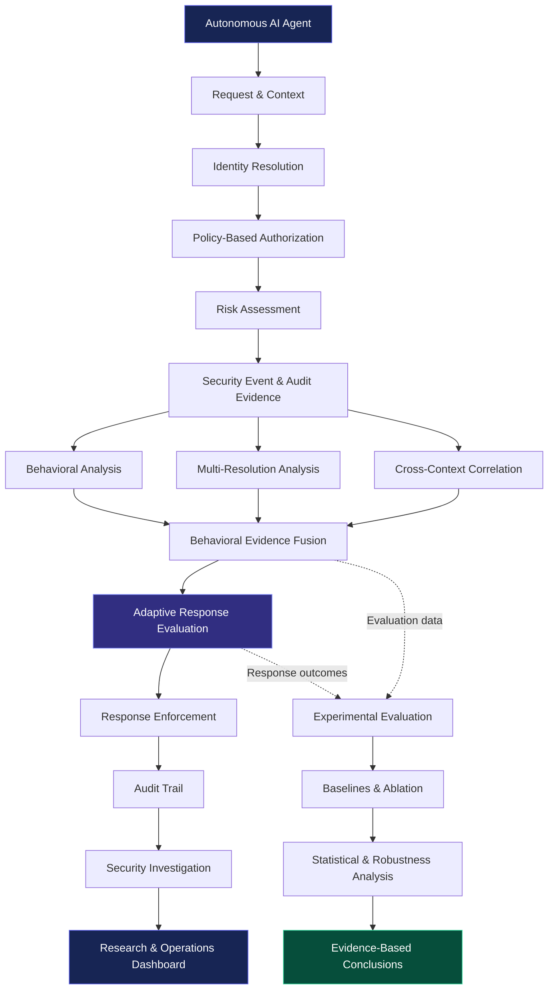
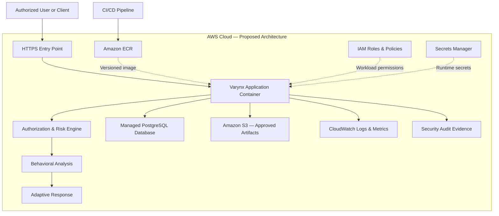

<div align="center">

# VARYNX

### Behavioral Intelligence. Adaptive Defense. Trustworthy AI.

**A behavior-aware runtime security research framework for autonomous AI agents.**

[Research & Development](#-research-philosophy) · [Architecture](#-system-architecture) · [Security Engine](#-core-capabilities) · [Evaluation](#-experimental-evaluation) · [AWS Roadmap](#-cloud-native--aws-roadmap) · [Getting Started](#-getting-started)

<br/>

[](https://www.python.org/)
[](https://streamlit.io/)
[](https://pytest.org/)
[](https://aws.amazon.com/)
[](#-research-philosophy)
[](LICENSE)

<br/>

*Moving beyond permission checks toward context-aware, behavior-informed runtime security.*

</div>

---

## ◈ Overview

**Varynx** is a research-oriented cybersecurity framework that investigates how behavioral evidence can strengthen runtime security decisions for autonomous AI agents.

As AI agents gain the ability to interact with APIs, databases, files, cloud services, external tools, and other agents, traditional authorization becomes only one part of the security problem.

A request may be technically permitted while still appearing inconsistent with an agent's task, historical behavior, or current operational context.

Varynx explores how authorization, risk assessment, behavioral analytics, multi-resolution analysis, cross-context correlation, and adaptive response can work together to provide richer security evidence.

Rather than assuming that more signals automatically produce better security, Varynx emphasizes controlled experimentation, baseline comparison, statistical analysis, adversarial evaluation, and reproducibility.

The long-term objective is to develop a **maintainable, explainable, experimentally defensible, and cloud-deployable behavioral risk control engine for autonomous AI agents.**

> [!IMPORTANT]
> Varynx is a research and engineering project. Its architecture and evaluation framework are designed to investigate measurable security benefits—not to claim universal novelty, guaranteed protection, or superiority over existing approaches without evidence. AWS deployment is a planned engineering milestone and must not be considered complete until implemented and verified.

---

## ◈ The Problem: Permission Is Not the Whole Story

Autonomous agents can perform complex, multistep operations across interconnected systems. A single request may appear harmless when evaluated in isolation, while a sequence of requests may reveal a different pattern.

Consider an agent that is authorized to read sales reports.

Initially, it accesses an expected report. Later, it begins exploring unrelated resources, repeatedly attempts denied operations, and expands its activity across additional contexts.

A conventional authorization mechanism can determine whether each action is permitted. Behavioral analysis may provide additional evidence about whether the sequence deserves closer investigation.

Varynx investigates the relationship between these two perspectives.

| Traditional security question | Additional Varynx research question |
|---|---|
| Is the agent authorized? | Is the action consistent with the current task? |
| Is the requested resource permitted? | Is resource usage changing unexpectedly? |
| Was the individual request allowed or denied? | Does the sequence reveal repeated policy probing? |
| Is the current operation high-risk? | Are multiple behavioral signals reinforcing one another? |
| Should the request be blocked? | Would monitoring, verification, restriction, or human review be more appropriate? |
| What happened during the request? | What evidence explains the decision over time? |

**The objective is not to replace deterministic authorization. It is to investigate whether behavioral intelligence can provide useful additional security evidence.**

---

## ◈ Research Philosophy

Varynx is built around a testable proposition:

> Combining behavioral evidence across multiple resolutions and contexts may provide useful security information beyond simpler authorization and request-level risk baselines.

This proposition must be evaluated experimentally.

The project therefore emphasizes:

- Deterministic authorization and policy enforcement.
- Explainable risk assessment.
- Evidence-driven behavioral analysis.
- Cross-context and temporal reasoning.
- Graduated security responses.
- Structured audit evidence.
- Controlled security scenarios.
- Quantitative baseline comparisons.
- Repeated and reproducible experiments.
- Statistical analysis and uncertainty reporting.
- Robustness and adversarial evaluation.
- Operational performance measurements.

The framework treats research results as evidence to be examined, not conclusions to be assumed.

### Research principles

**01 — Authorization remains fundamental**

Behavioral signals must not silently override mandatory access-control rules.

**02 — Risk is evidence, not truth**

A numerical risk score is an input to decision-making, not definitive proof of malicious intent.

**03 — Anomalies require context**

Legitimate activity can be unusual. Detection quality must account for false positives as well as false negatives.

**04 — Every additional component must justify itself**

Ablation studies and baseline comparisons help determine whether individual components contribute measurable value.

**05 — Decisions should be explainable**

Security events should preserve sufficient evidence to understand how a decision was reached.

**06 — Research must be reproducible**

Experimental conclusions must be supported by recorded configurations, datasets, execution details, and actual results.

---

## ◈ System Architecture

Varynx follows a layered architecture in which authorization, risk assessment, behavioral intelligence, response selection, and investigation have distinct responsibilities.

### High-level workflow



*The diagram describes the intended logical architecture. The completeness of each integration must be established through repository inspection and testing.*

### Architectural layers

| Layer | Responsibility |
|---|---|
| Identity and context | Associate requests with an agent, task, action, resource, and relevant context |
| Authorization | Evaluate requests against applicable security policies |
| Risk assessment | Calculate and classify risk using the available evidence |
| Audit evidence | Record structured security events and decision context |
| Behavioral intelligence | Analyze observed activity and behavioral changes |
| Multi-resolution analysis | Examine activity at different levels of aggregation |
| Cross-context correlation | Investigate relationships between behavior across contexts |
| Adaptive response | Select an appropriate response based on defined policies and evidence |
| Investigation | Filter, correlate, and examine security events |
| Research evaluation | Compare configurations, measure outcomes, and assess limitations |
| Operations interface | Present relevant security, investigation, and evaluation information |

---

## ◈ Core Capabilities

### 01. Agent Identity and Context

Varynx associates security events with contextual information that can support authorization, risk evaluation, behavioral analysis, and investigation.

Representative event attributes include:

```text
agent_id
task_id
action
resource
timestamp
policy_context
decision
risk_score
reason
```

The exact schema should be taken from the current implementation.

Context provides a foundation for interpreting an action in relation to the agent's role and task rather than evaluating every request without surrounding information.

### 02. Policy-Based Authorization

The authorization layer evaluates whether an agent may perform a particular action against a particular resource.

**Example:**

```text
Agent:      data-analysis-agent
Task:       daily-report
Action:     read
Resource:   sales_database

Decision:   ALLOW
```

An unauthorized request might produce:

```text
Agent:      data-analysis-agent
Task:       daily-report
Action:     delete
Resource:   private_customer_records

Decision:   DENY

Reason:     Requested operation is not permitted
            by the applicable security policy
```

These examples illustrate the intended security model; they are not claims about specific runtime output.

Authorization remains a mandatory enforcement boundary. A low risk score or trusted behavioral history must not grant permissions that the applicable policy denies.

### 03. Contextual Risk Assessment

Risk assessment provides additional information for prioritization, monitoring, and response selection.

Potential inputs include:

- Existing risk indicators.
- Authorization outcomes.
- Repeated denied operations.
- Behavioral deviations.
- Resource diversity.
- Temporal activity patterns.
- Cross-context evidence.
- Multi-resolution features.

A risk assessment may help distinguish ordinary activity from activity requiring further scrutiny.

However, risk quality depends on feature quality, calibration, data coverage, and the evaluation methodology.

**A score alone does not establish malicious intent.**

### 04. Security Events and Audit Evidence

Structured security events provide a foundation for historical analysis and investigation.

A representative event may contain:

```json
{
  "timestamp": "2026-10-25T10:30:00Z",
  "agent_id": "data-analysis-agent",
  "task_id": "daily-report",
  "action": "read",
  "resource": "sales_database",
  "decision": "ALLOW",
  "risk_score": 18,
  "reason": "Illustrative low-risk decision"
}
```

This is an illustrative example, not an actual event retrieved from a running Varynx instance.

Audit evidence can support:

- Historical reconstruction.
- Behavioral profiling.
- Risk and decision analysis.
- Investigation timelines.
- Research dataset generation.
- Reproducible security experiments.
- Operational troubleshooting.

Audit records should be protected against unauthorized modification, excessive retention, and accidental disclosure of sensitive information.

### 05. Behavioral Profiling

Behavioral profiling investigates what an agent's observed activity looks like over time.

Potential features include:

```text
request_count
allow_count
deny_count
deny_rate
average_risk
maximum_risk
high_risk_count
unique_resources
unique_actions
unique_tasks
request_frequency
resource_diversity
action_diversity
```

These features may help identify changes in activity patterns.

A deviation is a signal for analysis—not automatic proof of compromise.

Behavioral baselines must also account for new agents, sparse observations, legitimate changes in workload, and the possibility of manipulated historical data.

### 06. Multi-Resolution Behavioral Analysis

A behavior pattern may look ordinary at one level and unusual when examined across several levels.

Varynx investigates behavioral evidence across resolutions such as:

```text
Individual action
      ↓
Capability
      ↓
Resource
      ↓
Task or context
      ↓
Agent
      ↓
Population or cross-agent activity
```

Potential analytical dimensions include:

- Action diversity.
- Capability diversity.
- Resource diversity.
- Context diversity.
- Temporal behavior.
- Denial patterns.
- Risk distribution.
- Behavioral entropy.

The research objective is to determine whether multiple resolutions reveal useful evidence that isolated request-level analysis misses.

### 07. Cross-Context Behavioral Correlation

Autonomous agents may operate across several tasks, resources, or operational contexts.

Varynx investigates whether relationships among these observations provide useful security evidence.

```text
Context A ── Capability X ── Resource A
    │
    └── Behavioral relationship

Context B ── Capability Y ── Resource B
    │
    └── Behavioral relationship

Context C ── Capability Z ── Resource C
```

Cross-context analysis can help identify broader activity patterns, but correlation may also produce misleading relationships.

The system must therefore preserve the distinction:

**Correlation ≠ malicious intent.**

### 08. Adaptive Security Response

Varynx investigates graduated responses rather than relying exclusively on a binary allow-or-deny outcome.

The historical intended risk-to-response mapping is:

| Risk level | Intended response | Purpose |
|---|---|---|
| LOW | `ALLOW` | Permit an action when applicable controls allow it |
| MODERATE | `ALLOW_WITH_MONITORING` | Permit the action with additional observation |
| ELEVATED | `STEP_UP_VERIFICATION` | Require additional verification where supported |
| HIGH | `RESTRICT` | Apply an appropriate restriction |
| CRITICAL | `DENY` | Deny the action under the applicable policy |

The actual implementation, thresholds, response enums, and enforcement paths must be verified against the current source code.

Additional response concepts may include:

- `REDUCE_SCOPE`
- `HUMAN_REVIEW`
- `BLOCK`

These should be documented as implemented only when the corresponding behavior exists and has been tested.

Adaptive response is not intended to weaken mandatory authorization controls. Instead, it investigates how additional security evidence can inform the handling of otherwise policy-compliant activity.

### 09. Security Investigation

The investigation layer provides a structured way to explore security events.

The documented investigation design includes filters for:

- Agent.
- Task.
- Action.
- Resource.
- Decision.
- Risk level.
- Risk range.
- Time range.
- Event lookup.

Programmatic investigation may also support:

- Agent profiles.
- Investigation timelines.
- Risk histories.
- Decision histories.
- Suspicious-event identification.
- Evidence aggregation.
- Structured investigation reports.

The investigation interface should make it possible to move from an individual alert to the surrounding evidence without treating a suspicious indicator as conclusive proof.

---

## ◈ Controlled Security Scenarios

Controlled scenarios provide repeatable conditions for evaluating the security engine.

| Scenario | Behavior under investigation | Evaluation objective |
|---|---|---|
| Unauthorized resource access | Request to access a prohibited resource | Verify policy enforcement |
| Repeated-denial probing | Repeated attempts at denied operations | Evaluate repeated-abuse indicators |
| Privilege expansion | Progressive requests for more sensitive capabilities | Evaluate escalation evidence |
| Behavioral drift | Change in an agent's established activity | Assess deviation detection |
| High-risk burst | Concentrated activity associated with elevated risk | Evaluate monitoring and response |
| Legitimate high activity | Unusually high volume of valid operations | Measure false-positive behavior |
| Cross-context activity | Related activity across multiple contexts | Evaluate correlation usefulness |
| Sparse observations | Limited history for an agent | Evaluate cold-start limitations |

For each scenario, define:

1. The threat model.
2. The initial conditions.
3. The ground-truth label.
4. The expected security properties.
5. The execution procedure.
6. The observed decision.
7. The metrics to calculate.
8. The limitations of the result.

The evaluation must distinguish malicious behavior from legitimate unusual behavior wherever the scenario design permits.

---

## ◈ Experimental Evaluation

Varynx treats research validation as a core engineering activity.

A functioning feature is not sufficient evidence that the feature improves detection, response quality, or operational security.

The evaluation workflow is designed to support:

```text
Controlled Scenario
        ↓
Ground Truth
        ↓
Dataset Generation
        ↓
Detector Execution
        ↓
Baseline Comparison
        ↓
Repeated Evaluation
        ↓
Statistical Analysis
        ↓
Ablation & Robustness
        ↓
Performance Evaluation
        ↓
Evidence-Based Conclusion
```

### Detection metrics

Depending on the experiment, relevant metrics include:

- Accuracy.
- Precision.
- Recall.
- F1 score.
- Specificity.
- False-positive rate.
- False-negative rate.
- Detection latency.

Metrics must be calculated using clearly defined labels and denominators.

Accuracy alone may be misleading when the dataset contains a highly imbalanced number of legitimate and malicious events.

### Operational metrics

Potential measurements include:

- Decision latency.
- Event-processing latency.
- Throughput.
- CPU utilization.
- Memory consumption.
- Database overhead.
- Audit logging overhead.
- Additional cost per processed event, where measurable.

Report the measurement environment and workload so that performance results can be interpreted correctly.

### Baseline comparison

Varynx should be compared with simpler approaches under comparable conditions.

Potential baselines include:

1. Authorization-only decisions.
2. Authorization with static risk thresholds.
3. Authorization with selected behavioral features.
4. Multi-resolution behavioral analysis.
5. Cross-context correlation.
6. The full evaluated Varynx configuration.

Only implement baselines that are meaningful for the actual system and research questions.

### Ablation studies

Ablation experiments investigate the contribution of individual components.

Potential configurations include:

```text
Full evaluated configuration

Without behavioral features

Without multi-resolution analysis

Without cross-context correlation

Without adaptive response

Without dynamic trust, if implemented
```

The experiment should isolate one component at a time where possible and document interactions that prevent a clean isolation.

### Threshold sensitivity

Threshold evaluation should investigate how changing decision boundaries affects:

- Precision and recall.
- False-positive and false-negative rates.
- Response severity.
- Detection latency.
- Operational overhead.

Thresholds should not be presented as optimal merely because they produce favorable results on the dataset used to select them.

### Statistical analysis

Where appropriate, experiments should record:

- Trial count.
- Random seeds.
- Dataset and scenario sizes.
- Mean and variability.
- Confidence intervals.
- Statistical tests and assumptions.
- Effect sizes.
- Known biases and limitations.

Statistical significance must be supported by actual calculations.

### Robustness and adversarial evaluation

The evaluation roadmap includes:

- Behavioral drift.
- Low-and-slow misuse.
- Repeated-denial evasion.
- Cross-context evasion.
- Behavioral baseline manipulation.
- Sparse observations.
- Legitimate unusual behavior.
- Threshold variation.
- Different event volumes.
- Different attack ratios.
- Distribution shifts.

The objective is to understand where the system works, where it fails, and how reliable its evidence remains under changing conditions.

### Reproducibility

A reproducible experiment should preserve:

- Code commit identifier.
- Dataset version or generation parameters.
- Configuration.
- Random seeds.
- Dependency versions.
- Execution command.
- Environment details.
- Machine-readable outputs.
- Metric definitions.
- Known limitations.

**No benchmark, accuracy figure, statistical result, or performance improvement should be reported as measured until the corresponding experiment has actually been executed.**

---

## ◈ Research Questions

The project is organized around testable research questions.

**RQ1 — Context-aware authorization**

Can task- and context-aware authorization reduce unauthorized autonomous-agent actions compared with simpler permission checks?

**RQ2 — Behavioral evidence**

Can historical behavior provide useful evidence for identifying suspicious agent activity?

**RQ3 — Multi-resolution analysis**

Does analyzing activity at multiple resolutions reveal security signals that are difficult to observe from individual actions alone?

**RQ4 — Cross-context correlation**

Can cross-context behavioral evidence improve detection without producing unacceptable false-positive rates?

**RQ5 — Adaptive enforcement**

Can graduated response increase security scrutiny while avoiding unnecessary disruption to legitimate activity?

**RQ6 — Component contribution**

Do behavioral, multi-resolution, cross-context, and adaptive-response components provide measurable benefits individually and in combination?

**RQ7 — Operational feasibility**

Can the additional behavioral analysis be executed with acceptable latency, throughput, and resource overhead?

These questions define the investigation agenda. Their answers remain dependent on the quality of the experimental evidence.

---

## ◈ Technology Stack

The documented development stack includes the following technologies.

| Technology | Role |
|---|---|
| Python | Core security engine and research implementation |
| SQLite | Local persistence and security-event storage |
| Streamlit | Research and security operations interface |
| Pandas | Data preparation and analytical processing |
| Pytest | Automated testing |
| SciPy | Statistical analysis where required |
| Scikit-learn | Experimental machine-learning and anomaly-detection research |
| Git | Version control |
| GitHub | Source-code collaboration and project hosting |

Additional technologies should be introduced only when justified by a clear engineering or research requirement.

### Cloud technology direction

The proposed AWS deployment architecture will be selected after auditing the existing application and persistence model.

Candidate services include:

- Amazon ECS with AWS Fargate.
- Amazon ECR.
- Amazon RDS for PostgreSQL, subject to compatibility requirements.
- Amazon S3.
- Amazon CloudWatch.
- AWS IAM.
- AWS Secrets Manager.
- AWS KMS.
- AWS CloudTrail.
- GitHub Actions with AWS OIDC federation.

These are candidates, not a declaration that the services have already been integrated.

---

## ◈ Cloud-Native & AWS Roadmap

Varynx is intended to evolve from a locally testable research framework toward a secure, deployable cloud-native application.

The migration should preserve the existing security-engine responsibilities while introducing cloud capabilities only where they add operational value.

### Proposed deployment architecture



*This is a proposed logical architecture. Network boundaries, authentication, database compatibility, service selection, and deployment configuration must be finalized before provisioning resources.*

### Candidate AWS components

| Component | Candidate service | Intended purpose |
|---|---|---|
| Application runtime | Amazon ECS with AWS Fargate | Run containerized Varynx workloads |
| Container registry | Amazon ECR | Store versioned application images |
| Persistent database | Amazon RDS for PostgreSQL | Managed persistence if compatible with the application |
| Research artifacts | Amazon S3 | Store approved datasets, experiment outputs, and reports |
| Monitoring | Amazon CloudWatch | Collect operational logs, metrics, and alarms |
| Permissions | AWS IAM | Apply least-privilege workload permissions |
| Secrets | AWS Secrets Manager | Manage sensitive runtime configuration |
| Encryption | AWS KMS | Support appropriate encryption-key management |
| Account audit | AWS CloudTrail | Record relevant AWS account activity |
| Delivery automation | GitHub Actions with AWS OIDC, or an appropriate AWS-native pipeline | Automate validation and approved deployment |

### Recommended implementation sequence

**Stage 1 — Application readiness**

- Verify startup and shutdown behavior.
- Validate configuration handling.
- Establish repeatable tests.
- Improve structured logging and health checks.
- Resolve critical security and integration defects.

**Stage 2 — Containerization**

- Create a production-appropriate Dockerfile if containers fit the architecture.
- Pin dependencies appropriately.
- Avoid running as root where practical.
- Exclude secrets and unnecessary files from the image.
- Test the container locally.

**Stage 3 — Persistence and storage**

- Inspect the current SQLite persistence layer.
- Determine whether managed PostgreSQL is needed.
- Evaluate migration requirements.
- Check compatibility with any TimescaleDB-specific functionality.
- Establish backup, recovery, and migration procedures.
- Add S3 only where persistent object storage is justified.

**Stage 4 — AWS security and observability**

- Configure workload identities and least-privilege IAM policies.
- Protect secrets.
- Define network boundaries.
- Configure appropriate logging, metrics, and alarms.
- Avoid exposing databases and internal services publicly.

**Stage 5 — CI/CD and staging**

- Run tests before building deployment artifacts.
- Scan dependencies and container images.
- Validate infrastructure configuration.
- Deploy to a non-production environment after approval.
- Run smoke tests and security checks.

**Stage 6 — Production-readiness assessment**

- Verify authorization and enforcement paths.
- Review unresolved security findings.
- Test monitoring and rollback.
- Validate backup and recovery requirements.
- Estimate operating costs.
- Document the operational responsibilities and limitations.

### Important database consideration

The existing project documentation identifies SQLite as the local data store. A future PostgreSQL deployment should therefore be treated as a potential migration, not an assumed replacement.

If the application depends on TimescaleDB-specific features, verify that the selected managed database supports the required extensions and functionality before proceeding.

### Cloud security principles

- Prefer temporary AWS credentials and workload identities.
- Never commit cloud credentials or secrets.
- Use least-privilege permissions.
- Keep databases private unless a documented requirement dictates otherwise.
- Use TLS and suitable encryption controls.
- Separate development, staging, and production configurations.
- Apply resource limits and budget monitoring.
- Test rollback and recovery procedures.
- Do not deploy infrastructure without explicit authorization.

**Deployment status:** AWS integration and deployment remain subject to implementation and verification in the actual repository and target environment.

---

## ◈ Project Structure

The following is a representative structure based on the documented project. Verify the current repository before relying on any individual filename.

```text
varynx/
│
├── app/
│   ├── authorization.py
│   ├── risk.py
│   ├── security.py
│   ├── audit.py
│   ├── analytics.py
│   ├── behavior.py
│   ├── attack_scenarios.py
│   ├── experimental_dataset.py
│   ├── evaluation.py
│   ├── comparison.py
│   ├── repeated_evaluation.py
│   ├── statistical_evaluation.py
│   ├── multiresolution_behavior.py
│   ├── cross_context_correlation.py
│   ├── adaptive_response.py
│   ├── event_schema.py
│   ├── investigation.py
│   └── ...
│
├── tests/
│   ├── test_authorization.py
│   ├── test_risk.py
│   ├── test_security.py
│   ├── test_audit_evidence.py
│   ├── test_event_schema.py
│   ├── test_investigation.py
│   └── ...
│
├── dashboard.py
├── requirements.txt
├── .gitignore
├── README.md
│
├── docs/
│   ├── architecture/
│   ├── research/
│   ├── security/
│   └── deployment/
│
├── tests/
│
└── infrastructure/
    └── ...
```

The `docs/` and `infrastructure/` directories are proposed organizational conventions; create them only if they fit the existing repository.

Runtime databases, generated experiment outputs, private audit logs, and secrets should normally remain outside version control.

---

## ◈ Getting Started

The following instructions reflect the documented Python, pytest, and Streamlit workflow. Confirm the actual repository structure and dependencies before running them.

### Prerequisites

- Python 3.x compatible with the project's dependencies.
- Git.
- PowerShell on Windows or an equivalent terminal.
- A working Python environment with the required packages installed.

### 1. Clone the repository

```powershell
git clone https://github.com/catherinajercy2007/AegisGuard-repository.git
cd aegis-agent-firewall
```

The clone URL and directory name reflect the existing repository information. If the repository has been renamed, use its current canonical URL and directory.

### 2. Create a virtual environment

```powershell
python -m venv .venv
```

Activate it in Windows PowerShell:

```powershell
.\.venv\Scripts\Activate.ps1
```

If PowerShell blocks activation under your local execution policy, follow your organization's security guidance rather than weakening system policy unnecessarily.

### 3. Install dependencies

```powershell
python -m pip install --upgrade pip
python -m pip install -r requirements.txt
```

Use the dependency versions supported by the project.

### 4. Run the automated tests

```powershell
python -m pytest -q
```

To run the tests with more detailed output:

```powershell
python -m pytest -v
```

Record the actual test results. A successful local run does not automatically establish research validity or production readiness.

### 5. Launch the dashboard

```powershell
python -m streamlit run dashboard.py
```

Open the local address displayed by Streamlit. The usual default is:

```text
http://localhost:8501
```

If the dashboard fails to start, verify the current application entry point, installed dependencies, and configuration.

### 6. Check your changes before committing

```powershell
git status
git diff --check
python -m pytest -q
```

Commit only the intended files:

```powershell
git add <modified-files>
git commit -m "Describe the change"
git push
```

Replace `<modified-files>` with the actual paths you intend to commit.

---

## ◈ Development Workflow

Varynx follows an incremental research and engineering workflow.

```text
Define the change
       ↓
Inspect dependencies
       ↓
Implement the change
       ↓
Run focused tests
       ↓
Run integration tests
       ↓
Run regression tests
       ↓
Validate research or operational behavior
       ↓
Review the diff
       ↓
Document the result
       ↓
Commit and push
```

### Definition of done

A task should not be considered complete merely because a source file exists or a single command succeeds.

Depending on its scope, completion may require:

- Implementation evidence.
- Unit tests.
- Integration tests.
- Regression validation.
- Security review.
- Experimental validation.
- Updated documentation.
- Reproducible execution instructions.

Distinguish implementation from testing and testing from experimental validation.

---

## ◈ Development Roadmap

Varynx has followed an incremental research and engineering plan spanning security foundations, behavioral analysis, experimental evaluation, investigation, and cloud deployment.

The original roadmap was organized into approximately 70 development days. The stages below summarize its major workstreams without assuming that every planned item has been completed.

| Phase | Focus | Intended outcome |
|---|---|---|
| I | Security foundation | Identity, authorization, policies, risk assessment, and audit foundations |
| II | Security analytics | Behavioral monitoring, suspicious-activity analysis, and investigation foundations |
| III | Controlled evaluation | Security scenarios, datasets, quantitative evaluation, and baseline comparison |
| IV | Behavioral intelligence | Statistical evaluation, multi-resolution analysis, cross-context correlation, and adaptive response |
| V | Validation and investigation | Integration correctness, explainability, threshold sensitivity, robustness, and investigation |
| VI | Advanced security engineering | Extended security evaluation, multi-agent considerations, observability, and cloud architecture |
| VII | Final research validation | Reproducibility, statistical analysis, performance measurements, security hardening, and research consolidation |
| VIII | Cloud deployment | Containerization, AWS integration, deployment automation, and operational validation |

### Near-term priorities

1. Reconcile all 47 tasks against the actual source code and test results.
2. Resolve security-critical correctness and integration defects.
3. Verify the dashboard and application behavior.
4. Complete the research experiments needed to support the intended claims.
5. Establish reproducible performance and robustness measurements.
6. Select the appropriate AWS architecture.
7. Prepare a non-production deployment.
8. Validate deployment, monitoring, security, and recovery procedures.
9. Document the remaining research and engineering limitations.

### Phase 2 direction

Future work may include:

- Dynamic behavioral trust.
- BCSE, according to its established project definition.
- Extended multi-agent behavior analysis.
- Additional adversarial scenarios.
- Further threshold calibration.
- Cloud-native operational integration.

The status of each item must be established from the implementation and research evidence before it is presented as completed functionality.

---

## ◈ Threat Model and Limitations

Varynx investigates security scenarios involving potentially compromised, misconfigured, or policy-violating autonomous agents.

Relevant behaviors include:

- Unauthorized resource access.
- Repeated policy violations.
- Privilege expansion.
- High-risk operations.
- Behavioral drift.
- Unusual resource exploration.
- Cross-context activity patterns.
- Suspicious multistep behavior.

The system does not assume that every unusual action represents an attacker.

### Known research limitations

The following limitations are relevant to the design and evaluation of a behavioral security framework:

- Synthetic datasets may not accurately represent real-world attack distributions.
- Behavioral baselines may be incomplete or outdated.
- Detection quality depends on the quality and coverage of available features.
- Anomaly detection can generate false positives.
- Novel or carefully staged attacks may evade existing rules.
- Cross-context correlation can produce misleading relationships.
- Risk scores do not prove malicious intent.
- Adaptive thresholds require appropriate calibration.
- Additional analysis introduces computational and storage overhead.
- Large-scale, distributed operation requires dedicated validation.
- Cloud deployment introduces additional identity, network, configuration, and operational risks.

These limitations should be evaluated and documented rather than concealed.

### Security assurance

Varynx should not be described as production-grade solely because its application starts or its unit tests pass.

A production deployment requires an appropriate review of its threat model, enforcement boundaries, deployment configuration, monitoring, recovery procedures, and operational risks.

---

## ◈ Novelty and Research Contribution

Varynx does not claim to be the first AI-agent security framework, the first behavioral security system, or a universally novel security solution.

The broader field already includes research and engineering approaches involving agent runtime protection, authorization, behavioral monitoring, tool-use security, runtime contracts, and adaptive defense.

The intended contribution is narrower and experimentally testable:

> **Investigating whether the combination of multi-resolution behavioral evidence, cross-context correlation, adaptive graduated enforcement, and reproducible evaluation provides measurable benefits over simpler autonomous-agent security baselines.**

The contribution must be established through:

- A clearly defined threat model.
- A defensible research methodology.
- Appropriate baseline comparisons.
- Ablation studies.
- Statistical analysis.
- Adversarial and robustness testing.
- Performance evaluation.
- Prior-art review.
- Explicit discussion of limitations.

No claim of superior security, universal novelty, or guaranteed protection should be made without evidence appropriate to that claim.

---

## ◈ Security and Privacy

Security data may contain sensitive information about agent behavior, resources, policies, and operational activity.

The development workflow should therefore follow these practices:

- Never commit API keys, cloud credentials, access tokens, or private keys.
- Keep local `.env` files and runtime secrets out of version control.
- Avoid storing unnecessary sensitive payloads in audit events.
- Restrict access to logs, datasets, and reports.
- Apply appropriate retention policies.
- Prefer controlled or synthetic datasets unless use of real data is authorized.
- Protect database backups and experiment artifacts.
- Use least-privilege permissions for local and cloud execution.
- Validate input data before using it in security decisions.
- Review error messages and logs for accidental disclosure.

Example `.gitignore` entries should be adapted to the actual repository:

```gitignore
# Python
__pycache__/
*.py[cod]
.venv/
venv/

# Environment and secrets
.env
.env.*
!.env.example
*.pem
*.key

# Runtime databases
*.db
*.sqlite
*.sqlite3

# Generated artifacts
.pytest_cache/
.coverage
htmlcov/
dist/
build/

# Local logs
*.log

# Editor and operating-system files
.vscode/
.idea/
.DS_Store
Thumbs.db
```

Review these patterns before applying them. In particular, do not ignore a file that is intentionally tracked or needed for reproducible testing.

---

## ◈ Current Project Status

**Project:** Varynx  
**Former name:** AegisGuard  
**Product:** Varynx Behavioral Risk Control Engine  
**Research title:** Cloud-Native Behavioral Risk Control for Autonomous AI Agents  
**Category:** Cybersecurity · AI Security · Autonomous Agent Security  
**Project type:** Research and engineering

### Documented implementation areas

The existing project documentation describes work in the following areas:

- Agent authorization.
- Risk assessment.
- Security analytics.
- Behavioral monitoring.
- Controlled security scenarios.
- Experimental dataset generation.
- Quantitative evaluation.
- Baseline comparison.
- Repeated evaluation.
- Statistical evaluation framework.
- Multi-resolution behavior.
- Cross-context correlation.
- Adaptive response.
- Event schema and audit evidence.
- Security investigation.

These areas should be individually checked against the current repository, their tests, and their integration points.

### Current engineering focus

The next stage is to establish a verified baseline and close the gap between documented functionality, tested behavior, research validation, and deployment readiness.

```text
Repository Audit
       ↓
47-Task Reconciliation
       ↓
Correctness & Security Validation
       ↓
Research Experiments
       ↓
AWS Architecture & Integration
       ↓
Non-Production Deployment
       ↓
Deployment Verification
       ↓
Final Research Documentation
```

### Status reporting principles

- Implemented code is not necessarily tested.
- Passing tests do not automatically establish research effectiveness.
- Existing benchmark scripts do not prove that benchmark results have been measured.
- Proposed AWS architecture does not mean that AWS resources have been deployed.
- A working demonstration does not automatically establish production readiness.

Update this section only when the corresponding status is supported by actual repository or execution evidence.

---

## ◈ Project Deliverables

The intended project deliverables include:

- Behavioral risk control engine.
- Policy-based authorization.
- Structured security event and audit architecture.
- Behavioral analysis pipeline.
- Multi-resolution behavioral analysis.
- Cross-context behavioral correlation.
- Adaptive response mechanisms.
- Security investigation capabilities.
- Controlled security scenarios.
- Reproducible experimental datasets.
- Quantitative evaluation framework.
- Baseline comparison.
- Repeated evaluation.
- Statistical analysis.
- Ablation studies.
- Threshold sensitivity evaluation.
- Robustness and adversarial evaluation.
- Performance benchmarks.
- Research and operations dashboard.
- Automated tests.
- Technical architecture documentation.
- Security and threat-model documentation.
- AWS deployment artifacts, where implemented.
- Final research report.

This list describes the intended deliverables, not a blanket assertion that every item has been completed and validated.

---

## ◈ Author

<div align="center">

### Catherina Jercy

**Cyber Security Engineering**  
Research interests: AI Agent Security · Behavioral Intelligence · Cloud Security · Adaptive Defense

[](https://github.com/catherinajercy2007)

</div>

---

## ◈ Disclaimer

Varynx is an educational and research-oriented cybersecurity project intended for security engineering, controlled experimentation, and academic investigation.

It should not be considered a complete production security solution without appropriate:

- Independent security review.
- Threat-model validation.
- Adversarial testing.
- Performance benchmarking.
- Operational monitoring.
- Deployment hardening.
- Access-control review.
- Backup and recovery validation.

No security system can guarantee complete protection against all attacks.

---

<div align="center">

## VARYNX

### Observe the behavior. Evaluate the risk. Enforce with evidence.

**Cybersecurity × Autonomous AI Agents × Behavioral Intelligence × Adaptive Security**

*Building a more evidence-driven approach to autonomous-agent runtime security.*

[Explore the Repository](https://github.com/catherinajercy2007/AegisGuard-repository) · [Connect on GitHub](https://github.com/catherinajercy2007)

</div>
